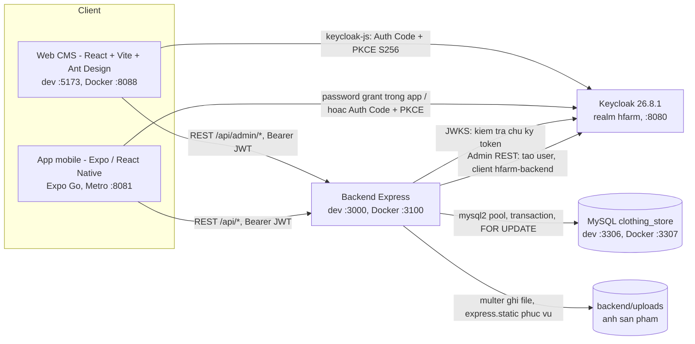
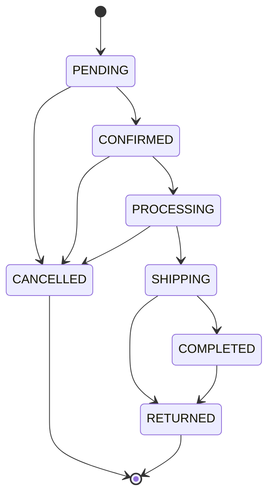

# Kiến trúc HFarm

> Viết theo code ngày 2026-11-18 (commit `09ed775`). Điều gì không xác minh được từ code ghi là "Chưa xác minh".
> Không có mật khẩu/secret thật trong file này; chỉ có TÊN biến và giá trị mẫu giả (`<...>`).

## 1. Sơ đồ tổng thể



Chế độ dev (`AUTH_ENABLED=false`, mặc định): không có Keycloak trong luồng; backend tự coi mọi request là một vai trò giả (xem mục 3.5).

## 2. Cấu trúc thư mục

```
<THU_MUC_DU_AN>/                 (đường dẫn có dấu cách, ví dụ ...\HTBanQA (1)\HTBanQA -> luôn bọc "..." khi cd)
├── CLAUDE.md                    quy tắc + bản đồ tài liệu, nạp mỗi phiên Claude
├── README.md                    hướng dẫn cài đặt gốc (chi tiết Keycloak, API); docs/ là bản đối chiếu theo code
├── docker-compose.yml           MySQL + backend + web (nginx), cổng 3307/3100/8088
├── .env.example                 biến cho docker compose (.env thật bị .gitignore)
├── docs/                        ARCHITECTURE, API, RUNBOOK, STATUS (thư mục này)
├── keycloak/themes/hfarm/login/ theme đăng nhập Keycloak: theme.properties (kế thừa keycloak.v2), resources/css/hfarm.css, resources/img (logo, favicon), messages (câu chữ). Không có .ftl. Cài bằng docker cp (RUNBOOK mục 2)
├── database/
│   ├── schema.sql               tạo DB clothing_store + 22 bảng + 2 view + dữ liệu mẫu size/màu/danh mục. XÓA SẠCH bảng khi chạy
│   └── migrations/              001_payment_shipping.sql (hạn trả, bank_transactions, shipping_zones, shipment_events), 002_banners.sql. Chạy ĐÚNG MỘT LẦN, chỉ thêm; backend không khởi động nếu thiếu
├── backend/                     Node.js + Express 4 + mysql2 + jose + multer
│   ├── index.js                 khởi động, CORS, mount route, bộ xử lý lỗi chung (ER_DUP_ENTRY -> 409...)
│   ├── .env.example             mẫu cấu hình (xem mục 6.1)
│   ├── Dockerfile               node:22-alpine, chạy bằng user node, có HEALTHCHECK
│   ├── scripts/setup-keycloak.js   cấu hình Keycloak 1 lần (npm run setup:keycloak)
│   ├── uploads/                 ảnh tải lên (chỉ .gitkeep nằm trong Git)
│   └── src/
│       ├── db.js                pool MySQL (decimalNumbers: true)
│       ├── utils.js             wrap, httpError, pick, paging (limit mặc định 10, tối đa 100), tx (transaction), uniqueSlug
│       ├── middleware/auth.js   authenticate, requireRole, assertAuthConfig (JWKS, issuer, đồng bộ bảng users)
│       ├── middleware/rateLimit.js   giới hạn theo IP trong bộ nhớ (chỉ dùng cho đăng ký)
│       ├── migrations.js        kiểm tra các migration đã áp dụng chưa khi khởi động (thiếu thì thoát kèm hướng dẫn)
│       ├── routes/              catalog (công khai, gồm banners), auth, payments (phương thức + webhook), shipping (ước tính phí + tra cứu vận đơn), me, cart, orders, favorites, reviews (khách), admin/* (CMS; có shipping, banners)
│       └── services/            orders (đặt hàng, đổi trạng thái, bulk), stock (đổi tồn kho + lịch sử),
│                                payments (VietQR, webhook, xác nhận tay, tự hủy đơn quá hạn), paymentConfig (đọc BANK_*), shipping (vùng + phí), tracking (hành trình),
│                                products (lọc/sắp xếp/gợi ý/liên quan), reviews, sizes (nhóm + thứ tự size), keycloakAdmin
├── web/                         CMS: React 18 + Vite 5 + Ant Design 5 + axios + keycloak-js + recharts
│   ├── Dockerfile, nginx.conf   build tĩnh rồi nginx phục vụ (SPA fallback); biến VITE_* nhúng lúc build
│   └── src/
│       ├── main.jsx, App.jsx    theme xanh #2E7D32, bảng route (AdminOnly cho trang chỉ admin)
│       ├── api.js               axios + gắn Bearer, làm mới token, xử lý 401/403
│       ├── auth/                keycloak.js (cấu hình, relogin), AuthProvider.jsx (vai trò), AdminOnly.jsx
│       ├── layouts/AdminLayout.jsx   menu, breadcrumb, chuông "Cần xử lý"
│       ├── pages/               Dashboard, Products (+ProductDrawer), Orders, Reviews, Customers, Coupons, Inventory, Attributes (Size & Màu), CrudPage (Danh mục/Thương hiệu), Shipping (vùng ship), BankTransactions, Banners
│       ├── components/          ConfirmButton, PageHeader, PersonCell
│       └── utils.js             money, trạng thái đơn (NEXT_STATUS phải khớp TRANSITIONS ở backend), validate
└── mobile/                      App khách hàng: Expo SDK 58, React Native 0.88, Expo Router, React Query
    ├── app.json                 scheme "hfarm" (redirect URI hfarm://...), plugin expo-secure-store...
    ├── AGENTS.md                hướng dẫn cho Expo + ghi chú dự án thật (JavaScript, chưa có lint/tsc)
    ├── PLAN.md                  kế hoạch + nhật ký kiểm tra từng giai đoạn (rất chi tiết; đầu file có đoạn cũ)
    ├── README.md                cách chạy mobile, lỗi kết nối, Keycloak cho mobile
    ├── .claude/settings.json    bật plugin expo cho Claude Code
    └── src/
        ├── app/                 màn hình (Expo Router): (tabs)/{index (Trang chủ), shop (Cửa hàng), cart, orders, account}, product/[id], order/[id], checkout,
        │                        order-success, login, profile, addresses, address-form, favorites, review
        ├── api/                 client.js (axios duy nhất) + products, cart, orders, me, addresses, favorites, reviews, auth
        ├── auth/                keycloak.js (lõi OAuth), AuthProvider.js, storage.js (SecureStore), passwordErrors.js
        ├── components/          Button, Card, LoginForm, LoginPanel, FilterSheet, SearchOverlay, ProductCard, ReviewSection, HeroCarousel, CategoryTiles, ProductRail, Skeleton, AddedToast, PaymentQR, Timeline...
        └── utils/               config (env), theme (bảng màu), format (tiền "1.250.000 ₫", ngày, ảnh, khoảng ngày giao), orderStatus, payment, useCart...
```

## 3. Xác thực và phân quyền

### 3.1 Đăng nhập web CMS (`web/src/auth/keycloak.js`)
- `keycloak-js`, client `hfarm-web` (public client). `init({ onLoad: 'login-required', pkceMethod: 'S256', checkLoginIframe: false })`: chưa đăng nhập thì chuyển sang trang đăng nhập của Keycloak.
- Token chỉ nằm trong bộ nhớ (không lưu localStorage). `web/src/api.js`: trước mỗi request gọi `updateToken(30)` rồi gắn `Authorization: Bearer ...`.
- Backend trả 401: web làm mới token cưỡng bức và gửi lại đúng một lần, vẫn lỗi thì `relogin()` (có chống lặp 15 giây bằng sessionStorage). Trả 403: web phát sự kiện `hfarm:forbidden` và hiện cảnh báo.
- Vai trò lấy từ `tokenParsed.realm_access.roles`. Không có `admin` lẫn `staff` thì `AuthProvider.jsx` chặn bằng màn "Bạn không có quyền truy cập". Phần này chỉ để giao diện gọn; **backend mới là nơi cưỡng chế quyền**.
- `VITE_AUTH_DISABLED=true`: bỏ Keycloak, gửi header `X-Dev-Role` (chỉ có tác dụng khi backend `AUTH_ENABLED=false`).
- Trang đăng nhập do **Keycloak** vẽ, không phải web: giao diện theo *Login theme* của realm. Theme của dự án là `hfarm` (`keycloak/themes/hfarm/login/`); realm chưa chọn thì vẫn là `keycloak.v2` mặc định. Theme chỉ đổi giao diện, không đổi luồng/client/token, nên web, app mobile và backend không phải sửa gì. Chữ tiếng Việt cần bật Internationalization trong realm (RUNBOOK mục 2).

### 3.2 Đăng nhập mobile (`mobile/src/auth/keycloak.js`)
Client `hfarm-mobile` (public client). Có hai đường, chọn theo cấu hình Keycloak/backend:

| Đường | Khi nào dùng | Cách làm |
|---|---|---|
| **Trong app** (mặc định ở UI) | Client bật Direct access grants | Form email + mật khẩu; `signInWithPassword` gọi thẳng `POST <issuer>/protocol/openid-connect/token` với `grant_type=password`, `client_id`, `scope=openid profile email` |
| **Trình duyệt** (dự phòng, "Quên mật khẩu?", "Đăng nhập/Tạo tài khoản bằng trình duyệt") | Client chưa bật Direct access grants (lỗi `unauthorized_client`/`invalid_client` -> hiện nút dự phòng) hoặc backend chưa bật đăng ký trong app | `expo-auth-session`: Authorization Code + PKCE S256 qua trình duyệt hệ thống; đăng ký dùng `prompt=create` (Keycloak >= 26.1) |

- Redirect URI = `makeRedirectUri({ scheme: 'hfarm', path: 'login' })`: Expo Go -> `exp://<IP_MAY_TINH>:8081/--/login` (khai trong client dạng `exp://<IP_MAY_TINH>:8081` và `exp://<IP_MAY_TINH>:8081/*`); development build/bản phát hành -> `hfarm://login` (khai `hfarm://*`). Bản dev in ra Metro dòng `[auth] Redirect URI đang dùng: ...`.
- Access token chỉ ở bộ nhớ, tự làm mới khi còn < 30 giây; refresh token lưu bằng `expo-secure-store`. API trả 401: làm mới cưỡng bức, gửi lại một lần, vẫn lỗi thì xóa phiên và về màn đăng nhập. Mất mạng khi làm mới thì giữ phiên.
- Đăng xuất: xóa token cục bộ + `POST end_session_endpoint` kèm refresh token (không mở trình duyệt).
- `EXPO_PUBLIC_AUTH_MODE=dev`: luôn "đã đăng nhập", gắn `X-Dev-Role: customer`.

### 3.3 Đăng ký ngay trong app (`backend/src/routes/auth.js`, `services/keycloakAdmin.js`)
1. App gọi `GET /api/auth/config` -> `{ registration: boolean }`. `true` khi `AUTH_ENABLED=true` **và** có đủ `KEYCLOAK_URL`, `KEYCLOAK_REALM`, `KEYCLOAK_ADMIN_CLIENT_ID`, `KEYCLOAK_ADMIN_CLIENT_SECRET`. Ngược lại app dùng trang đăng ký của Keycloak.
2. `POST /api/auth/register { email, password, full_name }`: giới hạn `REGISTER_RATE_LIMIT_MAX` (mặc định 10) lần / `REGISTER_RATE_LIMIT_WINDOW_MS` (mặc định 15 phút) / IP, trong bộ nhớ tiến trình. Kiểm tra: họ tên (<= 150 ký tự, không có `< > & " ( ) ; * = ?`...), email hợp lệ (<= 190), mật khẩu 8-128 ký tự.
3. Backend lấy token bằng **client `hfarm-backend`** (`grant_type=client_credentials`, `client_id` + `client_secret` từ biến môi trường, token được cache đến lúc gần hết hạn), rồi gọi **Keycloak Admin REST**:
   `POST /admin/realms/<realm>/users` (username = email, `enabled: true`, `emailVerified: false`, mật khẩu không tạm thời, họ tên tách `firstName`/`lastName`) -> `GET /roles/customer` -> `POST /users/<id>/role-mappings/realm`. Gán role lỗi thì `DELETE` luôn user vừa tạo.
4. Lỗi: 400 (dữ liệu sai hoặc mật khẩu chưa đạt chính sách của realm), 409 (email đã đăng ký), 429, 503 (chưa cấu hình/không tới được Keycloak; chi tiết chỉ ghi log).
5. App tự đăng nhập bằng password grant ngay sau khi đăng ký. Realm bắt xác minh email thì bước này báo cần hoàn tất thiết lập (app chuyển sang tab Đăng nhập).
6. Bảng `users` chỉ được tạo/đồng bộ ở lần gọi API có token đầu tiên (mục 3.4), không phải lúc đăng ký.

**`npm run setup:keycloak`** (`backend/scripts/setup-keycloak.js`), chạy bằng tài khoản quản trị Keycloak là `admin` ở realm **master** (không phải `admin_hfarm`, tài khoản đăng nhập CMS ở realm `hfarm`) (hỏi tên + mật khẩu lúc chạy, không lưu; hoặc `KC_ADMIN_USER`/`KC_ADMIN_PASSWORD` trong môi trường), đăng nhập `admin-cli` ở realm master bằng password grant rồi: (1) bật `directAccessGrantsEnabled` cho client `hfarm-mobile` (nếu client đã tồn tại); (2) tạo role `customer` nếu thiếu; (3) tạo client `hfarm-backend` (client bí mật, bật tài khoản dịch vụ, tắt standard flow/implicit/direct access); (4) cấp cho tài khoản dịch vụ các quyền `manage-users`, `view-users`, `query-users`, `view-realm` của `realm-management`; (5) lấy client secret và in ra, hoặc với `--write-env` ghi `KEYCLOAK_ADMIN_CLIENT_ID`/`KEYCLOAK_ADMIN_CLIENT_SECRET` vào `backend/.env` (hoặc file `ENV_FILE`). Chạy lại nhiều lần an toàn.

### 3.4 `backend/src/middleware/auth.js` kiểm tra theo thứ tự
`app.use('/api/admin', authenticate, requireRole('admin','staff'), ...)`; các router khách có `router.use(authenticate)`.

1. `AUTH_ENABLED !== 'true'` -> nhánh dev (mục 3.5), bỏ qua 2-4.
2. Có header `Authorization: Bearer <token>` không? Không -> **401** "Chưa đăng nhập".
3. `jwtVerify(token, JWKS, { issuer: danh sách })`: chữ ký (JWKS lấy từ `KEYCLOAK_URL/realms/<realm>/protocol/openid-connect/certs`), `iss` phải nằm trong `KEYCLOAK_ISSUERS` (để trống = chỉ `KEYCLOAK_URL/realms/<realm>`), hạn dùng `exp`. **Không** kiểm tra `aud`/`azp`.
   - Lỗi do token (hết hạn, sai chữ ký, sai issuer, hỏng...) -> **401** "Token không hợp lệ hoặc đã hết hạn" (sai issuer còn ghi log gợi ý thêm vào `KEYCLOAK_ISSUERS`).
   - Lỗi khác (không tới được Keycloak/JWKS hỏng) -> **503** "Không kết nối được máy chủ xác thực (Keycloak)" (để web không tưởng nhầm là hết phiên).
4. Lấy `sub`, `email`, `name`/`preferred_username`, `realm_access.roles`.
5. `syncUser`: tìm `users.keycloak_id = sub`; chưa có thì `INSERT` (email thiếu thì dùng `<sub>@no-email.local`), trùng `keycloak_id` do hai request song song thì dùng dòng đã có, còn không thấy dòng nào mà vẫn lỗi trùng = email đã thuộc tài khoản khác -> **409** "Email của tài khoản này đã được dùng bởi một tài khoản khác trong hệ thống" (không tự gộp vì email Keycloak có thể chưa xác minh). Đã có thì `UPDATE user_type` theo role (`admin` > `staff` > còn lại `CUSTOMER`) ở MỖI request. `users.status != 'ACTIVE'` -> **403** "Tài khoản đã bị khóa".
6. `req.user = { id, sub, name, email, roles }`; `requireRole(...)` không có role nào khớp -> **403** "Không đủ quyền".

**Phân biệt:** 401 = token thiếu/sai/hết hạn (client nên làm mới token hoặc đăng nhập lại); 403 = token đúng nhưng không đủ quyền hoặc tài khoản bị khóa (đăng nhập lại cũng vô ích); 503 = Keycloak không tới được (không phải lỗi người dùng).

### 3.5 Chế độ dev (`AUTH_ENABLED` khác `true`)
Không cần token. Vai trò = header `X-Dev-Role` (`admin|staff|customer`) nếu hợp lệ, không thì `DEV_ROLE` (mặc định `admin`). Danh tính giả: `sub = dev-<role>`, email giả dạng `<role>@...local`; vẫn được ghi vào bảng `users`. CORS mở cho mọi origin nếu không đặt `CORS_ORIGIN`. **Ai gọi được API cũng là admin -> không bao giờ mở ra Internet.**

### 3.6 Bảng phân quyền
Role lấy từ `realm_access.roles` của token đã xác minh (không bao giờ tin role do client gửi, trừ chế độ dev).

| Phạm vi | Endpoint / trang | Chưa đăng nhập | customer | staff | admin |
|---|---|---|---|---|---|
| Danh mục công khai | `GET /api/categories, brands, sizes, colors, products*, banners` | ✓ | ✓ | ✓ | ✓ |
| Thanh toán + giao hàng + thông tin cửa hàng công khai | `GET /api/payments/methods`, `GET /api/shipping/estimate`, `GET /api/tracking/:code` (giới hạn 30/phút/IP), `GET /api/store` (liên hệ + số ngày đổi trả, chỉ đọc `.env`) | ✓ | ✓ | ✓ | ✓ |
| Webhook ngân hàng | `POST /api/payments/webhook/sepay` (không dùng token người dùng: kiểm tra `PAYMENT_WEBHOOK_KEY`, tắt hẳn nếu chưa đặt) | khóa webhook | khóa webhook | khóa webhook | khóa webhook |
| Đăng ký | `GET /api/auth/config`, `POST /api/auth/register` | ✓ | ✓ | ✓ | ✓ |
| Dữ liệu của chính mình | `/api/me*`, `/api/cart*`, `/api/orders*` (gồm `/:id/payment`, `/:id/tracking`), `/api/favorites*`, `POST /api/reviews` | 401 | ✓ | ✓ | ✓ |
| CMS dùng chung | `/api/admin/me, products*, inventory, orders*` (gồm `confirm-payment`, `shipment-events`), `reviews*, stats*, upload, bank-transactions*`; `GET /api/admin/categories, brands, sizes, colors, shipping-zones` | 401 | 403 | ✓ | ✓ |
| CMS chỉ admin | `POST/PUT/DELETE /api/admin/categories, brands, sizes, colors, shipping-zones`; `/api/admin/users*`; `/api/admin/coupons*`; `/api/admin/banners*` | 401 | 403 | 403 | ✓ |
| Web: Tổng quan, Sản phẩm, Kho hàng, Đơn hàng, Đánh giá, Vận chuyển (xem), Giao dịch ngân hàng | `/`, `/products`, `/inventory`, `/orders`, `/reviews`, `/shipping`, `/bank-transactions` | - | không vào được CMS | ✓ | ✓ |
| Web: Khách hàng, Mã giảm giá, Danh mục, Thương hiệu, Size & Màu, Banner | `/customers`, `/coupons`, `/categories`, `/brands`, `/attributes`, `/banners` | - | - | chặn ở giao diện (`AdminOnly`) + 403 ở backend | ✓ |

## 4. Luồng đặt hàng (`backend/src/services/orders.js`)

`POST /api/orders` -> `createOrder`:
1. **Lấy hàng**: `body.items` (nếu là mảng không rỗng) hoặc giỏ `ACTIVE` của người dùng (app mobile luôn đặt từ giỏ). Giỏ trống -> 400 "Giỏ hàng trống". Gộp dòng trùng, sắp theo `variant_id` (tránh deadlock khi khóa kho).
2. **Địa chỉ**: `address_id` (phải thuộc người dùng, nếu không 400 "Địa chỉ không tồn tại") hoặc 6 trường rời (`recipient_name, recipient_phone, province, district, ward, address_detail`), thiếu -> 400 "Thiếu thông tin giao hàng". `payment_method` không thuộc `COD|BANK_TRANSFER|ONLINE` thì **âm thầm dùng `COD`**; `BANK_TRANSFER` mà chưa cấu hình `BANK_*` thì 400 "Cửa hàng chưa bật thanh toán chuyển khoản".
3. **Mở transaction** (`tx`):
   - Đặt từ giỏ: `SELECT ... FROM carts WHERE id=? FOR UPDATE`, phải còn `ACTIVE`, đọc lại `cart_items` trong transaction. Hai yêu cầu đồng thời cho một giỏ xếp hàng; yêu cầu sau thấy giỏ đã `CONVERTED` -> 400 "Giỏ hàng trống" (không tạo đơn thứ hai, không trừ kho lần nữa).
   - `priceLines`: đọc giá từng biến thể, phải `is_active` và sản phẩm `ACTIVE`, không thì 400 "Sản phẩm (mã N) không còn bán". Tạm tính = tổng `giá × số lượng`.
   - `applyCoupon` (khóa dòng coupon `FOR UPDATE`): mã còn `is_active`, trong `starts_at..ends_at`, đủ `min_order_amount`, còn `usage_limit`, chưa vượt `per_user_limit` (đếm `coupon_usages`). Giảm = `% × tạm tính` hoặc số tiền cố định, chặn bởi `max_discount` và tạm tính, làm tròn. Lỗi -> 400 kèm thông báo tiếng Việt.
   - **Phí ship** = `feeFor(tỉnh của địa chỉ, tạm tính)` trong `services/shipping.js`: tìm vùng (`shipping_zones`) liệt kê tỉnh đó (so khớp không phân biệt hoa thường/dấu/"Tỉnh"/"TP."), không có thì vùng mặc định; miễn phí khi **tạm tính >= `free_over` của vùng** (so với tạm tính trước giảm giá). Tổng = tạm tính - giảm + ship (`computeTotals`). Mặc định sau migration: 30.000 ₫, miễn phí từ 500.000 ₫.
   - **Mã đơn** `HT` + `yyyyMMdd` + 5 chữ số ngẫu nhiên. Trùng `order_code` (`ER_DUP_ENTRY` khớp `uq_orders_code`) thì tự thử mã khác, tối đa 5 lần (lỗi trùng chỉ hủy câu INSERT đó, transaction tiếp tục).
   - Mỗi dòng hàng: `INSERT order_items` (lưu bản chụp tên sản phẩm/SKU/size/màu/đơn giá) rồi `changeStock(... 'ORDER_DEDUCT')` trong `stock.js`: `SELECT quantity FROM inventories WHERE variant_id=? FOR UPDATE`, nếu `sau < 0` -> 400 "Không đủ tồn kho cho <tên (size/màu)> (còn N)" và **rollback toàn bộ**; thành công thì `UPDATE inventories` + `INSERT inventory_movements` (loại `ORDER_DEDUCT`, `quantity_before/after`, `reference_type='ORDER'`).
   - `INSERT payments` (phương thức, số tiền = tổng; `status` mặc định `PENDING`), `INSERT order_status_history` (`NULL -> PENDING`, "Khách đặt hàng"). `BANK_TRANSFER`: đặt `orders.payment_expires_at = NOW() + PAYMENT_HOLD_MINUTES`.
   - Có mã giảm giá: `INSERT coupon_usages` + `UPDATE coupons SET used_count = used_count + 1`.
   - Đặt từ giỏ: `UPDATE carts SET status='CONVERTED'`.
4. Trả `201 { id, order_code, subtotal, discount_amount, shipping_fee, total_amount, shipping_zone }`.

`POST /api/orders/quote` dùng **cùng hàm** `resolveItems/mergeLines/priceLines/applyCoupon/feeFor/computeTotals` nên luôn khớp với đặt hàng, nhưng **không ghi DB, không khóa, không kiểm tra tồn kho**.

Đặt hàng đồng thời: khóa dòng kho + dòng coupon + dòng giỏ, luôn theo thứ tự id tăng dần. Giỏ **không giữ chỗ**: hàng chỉ bị trừ lúc đặt. Đặt bằng `items` trong body (không qua giỏ) thì không có khóa chống gửi trùng.

### Hủy / hoàn trả / hoàn kho (`changeOrderStatus`)
- Khách: `POST /api/orders/:id/cancel`, chỉ khi `PENDING` (400 "Chỉ hủy được đơn đang chờ xác nhận"); đơn của người khác -> 404 ở `getOrderDetail`.
- Nhân viên: `PATCH /api/admin/orders/:id/status` (một bước) hoặc `POST /api/admin/orders/bulk` (CMS dùng cái này).
- Trong một transaction: `SELECT ... FROM orders WHERE id=? FOR UPDATE`, kiểm tra bước chuyển theo `TRANSITIONS` (sai -> 400 `Không thể chuyển từ "<nhãn>" sang "<nhãn>"`; nếu nhân viên vừa xác nhận thì khách hủy sẽ gặp lỗi này).
- Sang `CANCELLED` hoặc `RETURNED`: với mỗi `order_items` còn `variant_id`, `changeStock(... 'ORDER_RESTOCK')` cộng lại kho + ghi `inventory_movements`. Nếu `payment_status = 'PAID'` thì đặt `orders.payment_status` và `payments.status` = `REFUNDED`.
- **Hoàn lại lượt dùng mã giảm giá** (sửa 2026-11-24, trước đó lượt bị mất vĩnh viễn): xóa dòng `coupon_usages` của đơn và `coupons.used_count - 1` (không âm). Cần vì tự hủy đơn quá hạn sẽ làm mất lượt mã hàng loạt.
- Tùy chọn `requireUnpaid` (chỉ tác vụ tự hủy dùng): sau khi khóa dòng đơn mà `payment_status` không còn `UNPAID` (tiền vừa về) thì từ chối 409, không hủy đơn đã trả.

### Bảng trạng thái đơn (đối chiếu `TRANSITIONS` trong `orders.js`, web `NEXT_STATUS` trong `web/src/utils.js` khớp)

| Từ \ Sang | CONFIRMED | PROCESSING | SHIPPING | COMPLETED | CANCELLED | RETURNED |
|---|---|---|---|---|---|---|
| **PENDING** (Chờ xác nhận) | ✓ | | | | ✓ | |
| **CONFIRMED** (Đã xác nhận) | | ✓ | | | ✓ | |
| **PROCESSING** (Đang xử lý) | | | ✓ | | ✓ | |
| **SHIPPING** (Đang giao) | | | | ✓ | | ✓ |
| **COMPLETED** (Hoàn thành) | | | | | | ✓ |
| **CANCELLED** / **RETURNED** | trạng thái cuối, không chuyển tiếp | | | | | |



Tác dụng phụ khi đổi trạng thái (mọi lần đều ghi `order_status_history`):

| Sang | Việc làm thêm |
|---|---|
| CONFIRMED | `orders.confirmed_by` = người xử lý |
| SHIPPING | upsert `shipments` (`status=IN_TRANSIT`, `shipped_at=NOW()`); mã vận đơn nhập tay (<= 150 ký tự, không trùng đơn khác) hoặc tự sinh `HF` + yyMMdd + 6 ký tự (bỏ I, O, 0, 1); đơn vị vận chuyển nhập tay (<= 100 ký tự) hoặc `DEFAULT_CARRIER` (mặc định `HFarm Express`) |
| COMPLETED | `shipments.status=DELIVERED`, `delivered_at`; nếu `payment_status='UNPAID'` -> `PAID` (+ `payments.status=PAID`, `paid_at`), áp dụng cho mọi phương thức kể cả chuyển khoản. **Lưu ý**: đơn chuyển khoản chưa nhận tiền mà giao xong vẫn bị đánh dấu `PAID`; CMS cảnh báo "Chờ khách chuyển khoản" để nhân viên không giao khi chưa có tiền |
| CANCELLED, RETURNED | hoàn kho (xem trên), `PAID` -> `REFUNDED`. `shipments.status` KHÔNG đổi sang `RETURNED` |

**Xử lý hàng loạt** `POST /api/admin/orders/bulk` (`bulkOrderAction`, tối đa 100 đơn): `action` = `confirm` (PENDING), `ship` (CONFIRMED/PROCESSING; từ CONFIRMED tự đi qua PROCESSING rồi SHIPPING, mỗi bước một transaction nên có thể dừng giữa chừng), `complete` (SHIPPING), `cancel` (PENDING/CONFIRMED/PROCESSING), `return` (SHIPPING/COMPLETED). Đơn lỗi chỉ báo trong `results`, các đơn khác vẫn chạy. `tracking_code` chỉ nhận khi xử lý đúng một đơn.

### Thanh toán chuyển khoản VietQR (`services/payments.js`, `paymentConfig.js`)
1. Khách chọn "Chuyển khoản" (app chỉ hiện khi `GET /payments/methods` có `BANK_TRANSFER`, tức đã đặt `BANK_BIN`, `BANK_ACCOUNT_NO`, `BANK_ACCOUNT_NAME`). Đặt hàng như mục trên; đơn `PENDING` + `UNPAID` + `payment_expires_at`.
2. App mở `GET /orders/:id/payment`: server sinh chuỗi VietQR (EMVCo/NAPAS 247: tag 38 gồm GUID `A000000727`, BIN + số tài khoản, dịch vụ `QRIBFTTA`; tag 54 số tiền; tag 62/08 nội dung = mã đơn; CRC16-CCITT) và ảnh PNG (`qrcode`). App hiện QR, đếm ngược theo `seconds_left` (đồng hồ MySQL), hỏi lại mỗi 4 giây khi còn `payable`.
3. Tiền về, một trong hai đường: **webhook** `POST /payments/webhook/sepay` (`processIncomingTransfer`: ghi `bank_transactions` chống trùng, khóa dòng đơn, kiểm tra tài khoản nhận + số tiền, `markPaid`) hoặc **nhân viên** bấm "Xác nhận đã nhận tiền" (`confirmPaymentManually`, `provider = MANUAL`). `markPaid`: `orders.payment_status = PAID`, xóa `payment_expires_at`, `payments` PAID + `provider/transaction_code/paid_at`, thêm một dòng `order_status_history` giữ nguyên trạng thái ("Đã nhận chuyển khoản qua ngân hàng") để khách thấy mốc này.
4. Quá hạn: tác vụ chạy mỗi phút trong `index.js` (`expireUnpaidTransfers`, tắt bằng `PAYMENT_EXPIRE_JOB=false`) hủy đơn còn `PENDING` + `UNPAID` quá `payment_expires_at` qua `changeOrderStatus(..., { requireUnpaid: true })` (hoàn kho + hoàn lượt mã). Tiền về sau khi đã hủy -> `bank_transactions.match_status = ORDER_CLOSED`, đơn KHÔNG mở lại, nhân viên hoàn tiền ngoài hệ thống.
5. Khóa đua: webhook, xác nhận tay và tự hủy đều khóa dòng `orders ... FOR UPDATE`; webhook trùng id chỉ một lần thành công (`UNIQUE (provider, provider_tx_id)`).

### Giao hàng (`services/shipping.js`, `tracking.js`)
- Phí/thời gian giao theo vùng (mục Đặt hàng). Mã vận đơn vẫn tự sinh; đơn vị vận chuyển vẫn là `DEFAULT_CARRIER` hoặc nhập tay (chưa nối hãng nào).
- Hành trình = `order_status_history` (đổi trạng thái + mốc đã nhận tiền) + `shipment_events` (nhân viên ghi khi đơn đang giao, hiện cho khách trong app). `GET /tracking/:code` công khai chỉ trả các mốc vận chuyển, tên đã che, không SĐT/địa chỉ chi tiết/sản phẩm/tiền.
- Tem giao hàng in từ CMS (Orders > In phiếu giao hàng) có mã QR chứa mã vận đơn và dòng "Thu hộ (COD)" / "Đã thanh toán" / "Chưa nhận chuyển khoản".

## 5. Mô hình dữ liệu (`database/schema.sql`, MySQL 8, InnoDB, utf8mb4)

| Nhóm | Bảng | Quan hệ chính / ghi chú |
|---|---|---|
| Người dùng | `users` | `keycloak_id` (= `sub` của token) UNIQUE, `email` UNIQUE, `user_type` ADMIN/STAFF/CUSTOMER, `status` ACTIVE/INACTIVE/BLOCKED |
| | `addresses` | N-1 `users`; `is_default` |
| Danh mục hàng | `categories` (tự tham chiếu `parent_id`), `brands`, `products` (N-1 category, N-1 brand tùy chọn, `status` DRAFT/ACTIVE/INACTIVE), `sizes`, `colors` | `slug` UNIQUE |
| | `product_variants` | 1 sản phẩm × size × màu = 1 SKU (`uq_variant_combination`, `sku` UNIQUE); có `price`, `compare_at_price`, `is_active` |
| | `product_images` | N-1 `products`, `ON DELETE CASCADE`; `is_primary`, `sort_order` |
| Kho | `inventories` | 1-1 `product_variants` (`variant_id` UNIQUE), `quantity` không âm |
| | `inventory_movements` | sổ nhật ký: `IMPORT`, `EXPORT`, `ADJUSTMENT`, `ORDER_DEDUCT`, `ORDER_RESTOCK`; `quantity_before/after`, `reference_type/id` |
| Giỏ | `carts` (`ACTIVE`/`CONVERTED`/`ABANDONED`), `cart_items` | `uq_cart_variant (cart_id, variant_id)` |
| Khuyến mãi | `coupons`, `coupon_usages` | `code` UNIQUE; `used_count`; `uq_coupon_usage_order` |
| Đơn hàng | `orders` | 7 trạng thái, `payment_status`, `order_code` UNIQUE, địa chỉ chụp lại thành các cột (không FK tới `addresses`) |
| | `order_items` | bản chụp tên/SKU/size/màu/giá; `variant_id` `ON DELETE SET NULL` |
| | `order_status_history`, `payments`, `shipments` | `shipments`: `order_id` UNIQUE, `tracking_code` UNIQUE; `payments` hiện luôn 1 dòng/đơn; `orders.payment_expires_at` (migration 001) |
| Thanh toán + giao hàng (migration 001) | `bank_transactions` | tiền vào nhận qua webhook: `UNIQUE (provider, provider_tx_id)`, `match_status` MATCHED/UNMATCHED/AMOUNT_MISMATCH/ORDER_CLOSED/ALREADY_PAID, `resolved`, `raw` JSON |
| | `shipping_zones` | vùng ship: `provinces` JSON (NULL ở vùng mặc định `is_default`), `fee`, `free_over`, `eta_min_days/eta_max_days`; luôn có đúng một vùng mặc định |
| | `shipment_events` | mốc hành trình nhân viên ghi: N-1 `orders` (`ON DELETE CASCADE`) |
| Banner (migration 002) | `banners` | `link_type` NONE/CATEGORY/PRODUCT/COLLECTION + `link_value`, `sort_order`, `is_active`, `starts_at/ends_at` |
| Tương tác | `favorites` | `uq (user_id, product_id)` |
| | `reviews` | `status` PENDING/APPROVED/REJECTED, `rating` 1-5, `order_item_id` (không có UNIQUE trong DB: chống trùng bằng khóa dòng `order_items` trong code `createReview`) |
| View | `v_product_stock` | dùng ở `GET /api/admin/stats` (`low_stock`, ngưỡng <= 5) |
| | `v_order_summary` | **chưa được code nào dùng** |

Tính năng -> bảng: Cửa hàng (products, product_variants, product_images, inventories, categories, brands, sizes, colors, reviews đã duyệt); Giỏ (carts, cart_items); Đặt hàng (orders, order_items, payments, order_status_history, inventories, inventory_movements, coupons, coupon_usages, shipments khi giao); Yêu thích (favorites); Đánh giá (reviews); CMS Khách hàng (users); Kho hàng (inventories, inventory_movements).

Cột/giá trị có trong schema nhưng code chưa đặt: `shipments.status` PENDING/PICKING/FAILED/RETURNED; `orders.payment_status` PARTIALLY_REFUNDED/FAILED; `carts.status` ABANDONED; `product_images.alt_text`. `payments.provider/transaction_code` nay được đặt khi đơn chuyển khoản được xác nhận (`SEPAY` hoặc `MANUAL`). Cấu trúc đổi từ 2026-11-24 nằm trong `database/migrations/` (không sửa `schema.sql`; cách áp dụng: [RUNBOOK.md](RUNBOOK.md) mục Migration). Không có seed trong repo (muốn có sản phẩm phải nhập qua CMS).

## 6. Biến môi trường

Quy ước: giá trị mẫu là GIẢ. File `.env` thật bị `.gitignore` (`.env` ở gốc áp dụng cho mọi thư mục con); không bao giờ commit.

### 6.1 Backend (`backend/.env`, mẫu `backend/.env.example`)
| Biến | Ý nghĩa | Giá trị mẫu | Bắt buộc |
|---|---|---|---|
| `PORT` | Cổng backend | `3000` | Không (mặc định 3000) |
| `DB_HOST`, `DB_PORT` | MySQL | `localhost`, `3306` | Nên đặt |
| `DB_USER` | Tài khoản MySQL | `<DB_USER>` | Có |
| `DB_PASSWORD` | Mật khẩu MySQL | `<DB_PASSWORD>` | Có |
| `DB_NAME` | Tên database | `clothing_store` | Có |
| `AUTH_ENABLED` | `true` = bắt token Keycloak; khác = chế độ dev | `false` | Không (mặc định dev) |
| `DEV_ROLE` | Vai trò mặc định ở chế độ dev | `admin` | Không |
| `KEYCLOAK_URL` | Địa chỉ Keycloak mà BACKEND truy cập được (không có `/` cuối) | `http://localhost:8080` | Có nếu `AUTH_ENABLED=true` (thiếu thì backend không khởi động) |
| `KEYCLOAK_REALM` | Tên realm | `hfarm` | Có nếu `AUTH_ENABLED=true` |
| `KEYCLOAK_ISSUERS` | Các issuer chấp nhận, cách nhau dấu phẩy; để trống = `KEYCLOAK_URL/realms/<realm>` | `http://localhost:8080/realms/hfarm,http://<IP_MAY_TINH>:8080/realms/hfarm` | Không (cần khi web dùng `localhost` còn điện thoại dùng IP) |
| `KEYCLOAK_ADMIN_CLIENT_ID` | Client dịch vụ để tạo user | `hfarm-backend` | Chỉ để bật đăng ký trong app |
| `KEYCLOAK_ADMIN_CLIENT_SECRET` | Secret của client trên | `<CLIENT_SECRET>` | Như trên |
| `REGISTER_RATE_LIMIT_MAX` | Số lần đăng ký tối đa / cửa sổ / IP | `10` | Không |
| `REGISTER_RATE_LIMIT_WINDOW_MS` | Cửa sổ giới hạn (ms) | `900000` | Không |
| `DEFAULT_CARRIER` | Đơn vị vận chuyển mặc định (đọc lúc khởi động, đổi phải restart) | `HFarm Express` | Không |
| `BANK_BIN`, `BANK_ACCOUNT_NO`, `BANK_ACCOUNT_NAME`, `BANK_NAME` | Tài khoản nhận tiền cho QR VietQR. BIN = mã 6 số NAPAS của ngân hàng. Thiếu một trong ba biến đầu thì TẮT chuyển khoản (app chỉ còn COD). Không ghi giá trị thật vào code/docs: kho GitHub là công khai | `970436`, `0123456789`, `TEN CHU TK KHONG DAU`, `Vietcombank` (mẫu GIẢ) | Không (bật chuyển khoản thì có) |
| `PAYMENT_WEBHOOK_KEY` | Khóa webhook ngân hàng (SePay gửi `Authorization: Apikey <khóa>`). Trống = tắt webhook, nhân viên xác nhận tay | `<chuoi-ngau-nhien-dai>` | Không |
| `PAYMENT_HOLD_MINUTES` | Số phút giữ đơn chuyển khoản chưa trả (5 - 10080) | `1440` | Không (mặc định 24 giờ) |
| `PAYMENT_EXPIRE_JOB` | `false` = tắt tác vụ tự hủy đơn quá hạn | `true` | Không |
| `STORE_NAME`, `STORE_PHONE`, `STORE_ZALO`, `STORE_EMAIL`, `STORE_ADDRESS`, `STORE_HOURS` | Thông tin cửa hàng hiện trong app (màn Liên hệ, nút Gọi/Zalo/Email ở chi tiết đơn) qua `GET /api/store`. Trống hoặc sai định dạng thì app ẩn mục/nút tương ứng. Đọc mỗi lần gọi (đổi `.env` + restart backend là đủ, không phải build lại app). Không ghi số thật vào code/docs: kho GitHub là công khai | `0900000000`, `cskh@example.com` (mẫu GIẢ) | Không (nhưng không có thì app không có cách liên hệ) |
| `RETURN_DAYS` | Số ngày khách được yêu cầu đổi trả kể từ khi nhận hàng, hiện trong Chính sách đổi trả và lời nhắn ở đơn hàng (1 - 90) | `7` | Không (mặc định 7) |
| `CORS_ORIGIN` | Origin được gọi API, cách nhau dấu phẩy | `http://localhost:5173` | Không (trống: bật xác thực -> chỉ `http://localhost:5173`; dev -> mọi origin) |
| `PUBLIC_URL` | Origin công khai của backend, dùng làm URL ảnh tải lên (`/uploads/...`) | `http://localhost:3000` | Không (mặc định như mẫu). Chỉ cần đặt khi ảnh upload không hiện trên điện thoại; có dòng comment trong `backend/.env.example` |
| `ENV_FILE`, `KC_ADMIN_USER`, `KC_ADMIN_PASSWORD`, `KEYCLOAK_MOBILE_CLIENT_ID` | Chỉ dành cho `scripts/setup-keycloak.js` (file .env khác; tài khoản quản trị Keycloak = `admin` ở realm master; tên client mobile, mặc định `hfarm-mobile`) | `<...>` | Không |

### 6.2 Web (`web/.env`, mẫu `web/.env.example`; biến `VITE_*` nhúng lúc build/khởi động, đổi xong phải restart `npm run dev` hoặc build lại)
| Biến | Ý nghĩa | Giá trị mẫu | Bắt buộc |
|---|---|---|---|
| `VITE_API_URL` | Địa chỉ API (có `/api`) | `http://localhost:3000/api` | Có |
| `VITE_KEYCLOAK_URL` | Keycloak mà trình duyệt truy cập được | `http://localhost:8080` | Có nếu không `VITE_AUTH_DISABLED` |
| `VITE_KEYCLOAK_REALM` | Realm | `hfarm` | Như trên |
| `VITE_KEYCLOAK_CLIENT_ID` | Client công khai của web | `hfarm-web` | Như trên |
| `VITE_AUTH_DISABLED` | `true` = chạy CMS không Keycloak (chỉ khi backend `AUTH_ENABLED=false`) | `true` | Không |
| `VITE_DEV_ROLE` | `admin` (mặc định) hoặc `staff`, gửi qua `X-Dev-Role` | `admin` | Không |

### 6.3 Mobile (`mobile/.env`, mẫu `mobile/.env.example`; `EXPO_PUBLIC_*` nhúng vào bundle nên KHÔNG đặt bí mật; đổi xong chạy `npx expo start --clear`)
| Biến | Ý nghĩa | Giá trị mẫu | Bắt buộc |
|---|---|---|---|
| `EXPO_PUBLIC_API_URL` | API mà điện thoại truy cập được (IP LAN, không phải `localhost`; Android emulator `10.0.2.2`) | `http://<IP_MAY_TINH>:3000/api` | Có |
| `EXPO_PUBLIC_AUTH_MODE` | `dev` (mặc định) hoặc `keycloak` | `dev` | Không |
| `EXPO_PUBLIC_KEYCLOAK_URL` | Keycloak mà ĐIỆN THOẠI truy cập được; quyết định `iss` của token | `http://<IP_MAY_TINH>:8080` | Có nếu `keycloak` |
| `EXPO_PUBLIC_KEYCLOAK_REALM` | Realm | `hfarm` | Như trên |
| `EXPO_PUBLIC_KEYCLOAK_CLIENT_ID` | Client công khai của app | `hfarm-mobile` | Như trên |

### 6.4 Docker Compose (`.env` ở thư mục gốc, mẫu `.env.example`; tất cả có giá trị mặc định sau `:-` trong `docker-compose.yml`)
| Biến | Ý nghĩa | Giá trị mẫu | Bắt buộc |
|---|---|---|---|
| `API_PORT`, `WEB_PORT`, `DB_HOST_PORT` | Cổng trên máy: API, CMS, MySQL | `3100`, `8088`, `3307` | Không |
| `DB_PASSWORD` | Mật khẩu root MySQL trong container (chỉ có tác dụng lần tạo volume đầu) | `<DB_PASSWORD>` | Không (có giá trị mặc định ngay trong `docker-compose.yml`: chỉ dùng cho dev, đổi trước khi dùng thật) |
| `PUBLIC_URL` | Origin công khai của API; cũng dùng làm `VITE_API_URL` khi build web | `http://localhost:3100` | Không |
| `AUTH_ENABLED`, `DEV_ROLE`, `VITE_AUTH_DISABLED`, `VITE_DEV_ROLE` | Chế độ đăng nhập (mặc định dev) | `false`, `admin`, `true`, `admin` | Không |
| `KEYCLOAK_URL`, `KEYCLOAK_REALM`, `KEYCLOAK_ISSUERS`, `KEYCLOAK_ADMIN_CLIENT_ID`, `KEYCLOAK_ADMIN_CLIENT_SECRET`, `CORS_ORIGIN` | Chuyển thẳng vào backend (trong container, Keycloak trên máy là `http://host.docker.internal:8080`) | như mục 6.1 | Khi bật Keycloak |
| `VITE_KEYCLOAK_URL`, `VITE_KEYCLOAK_REALM`, `VITE_KEYCLOAK_CLIENT_ID` | Truyền làm build arg cho web | như mục 6.2 | Khi bật Keycloak |
| `DEFAULT_CARRIER` | Đơn vị vận chuyển mặc định | `HFarm Express` | Không |
| `STORE_NAME`, `STORE_PHONE`, `STORE_ZALO`, `STORE_EMAIL`, `STORE_ADDRESS`, `STORE_HOURS`, `RETURN_DAYS` | Thông tin cửa hàng hiện trong app (chuyển thẳng vào backend; trống = app ẩn mục liên hệ) | như mục 6.1 | Không |
| `BANK_BIN`, `BANK_NAME`, `BANK_ACCOUNT_NO`, `BANK_ACCOUNT_NAME`, `PAYMENT_WEBHOOK_KEY`, `PAYMENT_HOLD_MINUTES` | Thanh toán chuyển khoản VietQR + webhook (chuyển thẳng vào backend; trống = tắt chuyển khoản) | như mục 6.1 | Không |

MySQL trong Compose nạp `schema.sql` rồi các migration (`02-`, `03-` trong `docker-entrypoint-initdb.d`) CHỈ ở lần tạo volume đầu; volume đã có dữ liệu thì áp dụng migration tay (RUNBOOK). `MYSQL_DATABASE=clothing_store` để migration (không có lệnh `USE`) chạy đúng database.

Compose KHÔNG truyền `REGISTER_RATE_LIMIT_*` và `KEYCLOAK_MOBILE_CLIENT_ID` vào container.

## 7. Lưu ý bảo mật (trung thực, chưa sửa gì)

1. **Direct access grants (password grant) cho `hfarm-mobile`**: script `setup:keycloak` bật nó để app đăng nhập bằng form riêng. Hệ quả: ai biết `client_id` công khai cũng gửi được email + mật khẩu thẳng tới token endpoint, bỏ qua trang đăng nhập Keycloak (và mọi bước bổ sung như MFA nếu sau này bật); luồng này đã bị OAuth 2.1 loại bỏ. Chống đoán mật khẩu phụ thuộc "brute force detection" của realm (app có xử lý thông báo "tạm khóa" nhưng **chưa xác minh** realm đã bật). Trạng thái hiện tại của client trên Keycloak thật: **Chưa xác minh** (cần đăng nhập trang quản trị Keycloak bằng `admin` của realm master; theo ghi chú chủ dự án thì script chưa chạy trên Keycloak thật).
2. **Backend nhìn thấy mật khẩu thô** của người đăng ký (`POST /api/auth/register`), chỉ chuyển tiếp cho Keycloak, không ghi log/DB (theo code). Ở dev toàn bộ đi qua HTTP thường trong LAN.
3. **Client `hfarm-backend` có quyền rộng** (`manage-users`, `view-users`, `query-users`, `view-realm` của `realm-management`): lộ secret = có thể tạo/sửa/xóa người dùng của realm. Secret nằm trong `backend/.env` (bị `.gitignore`) hoặc biến môi trường Docker; không đưa vào Git/log.
4. **Đăng ký không xác minh email** (`emailVerified=false`, và realm có bắt xác minh hay không là **Chưa xác minh**): người khác có thể đăng ký bằng email của bạn; nếu email đó đã chiếm bảng `users` thì chủ thật gặp 409 ở lần gọi API đầu tiên. `POST /api/auth/register` trả 409 "Email này đã được đăng ký" cũng cho phép dò email nào đã có tài khoản.
5. **`auth.js` không kiểm tra `aud`/`azp`**: mọi access token hợp lệ của realm `hfarm` (kể cả cấp cho client khác) đều được nhận, miễn là role đúng.
6. **Chế độ dev**: ai gọi được API là admin (header tự khai), CORS mở cho mọi origin. Docker Compose mặc định ở chế độ này và mở cổng `3100`/`3307`/`8088` trên mọi giao diện mạng của máy.
7. Backend kết nối MySQL bằng `root` (cả `.env.example` lẫn Docker); chưa có tài khoản DB quyền tối thiểu.
8. Giới hạn tần suất đăng ký nằm trong bộ nhớ, theo `req.ip`; sau reverse proxy phải đặt `app.set('trust proxy', ...)` (hiện chưa có). Các endpoint khác không có giới hạn tần suất; chưa có `helmet`.
9. Keycloak chạy `start-dev` trên HTTP; log của Keycloak cảnh báo client `hfarm-web` còn bật "Full scope allowed" (tính năng sắp bị loại bỏ).
10. Tải ảnh (`POST /api/admin/upload`) kiểm tra đuôi tệp + `mimetype` do client khai (không đọc nội dung), giới hạn 5 MB, tên tệp ngẫu nhiên; `/uploads` phục vụ công khai không cần token.
11. **Webhook ngân hàng** (`/api/payments/webhook/sepay`) là route công khai duy nhất ghi dữ liệu thanh toán: an toàn dựa vào `PAYMENT_WEBHOOK_KEY` (so sánh thời gian cố định). Lộ khóa = ai cũng giả được giao dịch "tiền đã về" và làm đơn thành `PAID`. Dùng chuỗi dài ngẫu nhiên, chỉ đặt trong `backend/.env` và cấu hình ở SePay; không có kiểm tra chữ ký nội dung (SePay có HMAC, chưa cài). Webhook chỉ tin số tiền + mã đơn trong nội dung do ngân hàng ghi.
12. **Tra cứu vận đơn công khai** (`/api/tracking/:code`) không cần đăng nhập: mã vận đơn là bí mật yếu (6 ký tự ngẫu nhiên, ~10^9 khả năng) nên có giới hạn 30 lần/phút/IP (trong bộ nhớ) và chỉ trả tên đã che + tỉnh, không SĐT/địa chỉ chi tiết.
13. Số tài khoản ngân hàng của cửa hàng nằm trong `backend/.env`; API `/orders/:id/payment` trả nó cho chính khách đặt đơn (vì nó nằm trong mã QR). Không đưa số tài khoản thật vào repo (kho GitHub công khai).
